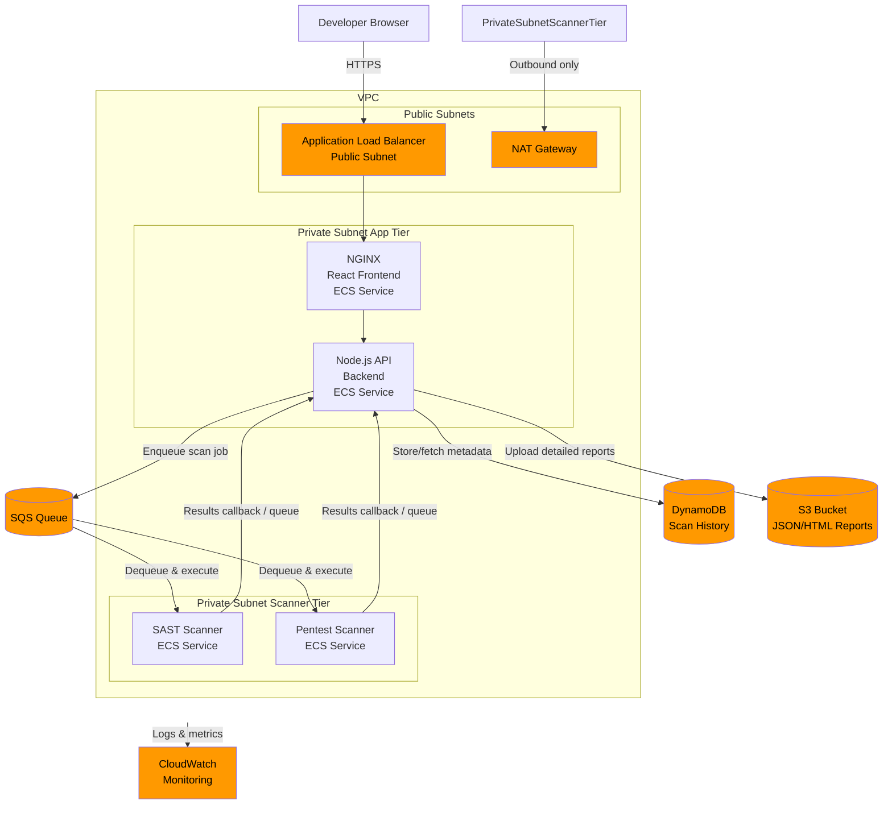

# QuickScan Hub — Unified Code & API Security Scanner
 
## Customer / Use Case
 
**Target user:** A small development team that wants a single web dashboard to run both static code analysis (SAST) and live API penetration tests — without installing anything locally.
 
**Problem it solves:** Developers currently have to run security tools on their own machines, results are scattered, and there's no shared history. QuickScan Hub gives the team a hosted platform where anyone can paste code or enter an API URL, get instant results, and browse historical scan data — all from a browser.
 
---
 
## Architecture Diagram
 

 
### Data Flow
 
1. User opens the React dashboard via the ALB's public DNS endpoint.
2. ALB terminates HTTPS and forwards traffic to the NGINX/frontend ECS service in the private app subnet.
3. User submits a **code snippet** (SAST) or a **target URL** (Pentest) via the UI.
4. The Node.js API backend publishes a **scan job message** to the **SQS queue** with the scan type, payload, and a unique scan ID. It immediately returns a `202 Accepted` with the scan ID so the frontend can poll for status.
5. The appropriate scanner ECS service polls SQS, picks up the job, runs the scan, and writes results back — either via a **results SQS queue** or a direct callback to the API's internal endpoint.
6. The API writes **scan metadata** (id, timestamp, summary counts, severity, status) to **DynamoDB** and uploads the **full report JSON** to **S3**.
7. The frontend polls or subscribes for scan completion, then fetches full reports from S3 on demand via pre-signed URLs.
8. CloudWatch collects ECS container logs and ALB/service metrics for health monitoring and alarms.
 
---
 
## VPC & Network Design
 
Security is a first-class concern because QuickScan Hub handles potentially malicious code snippets and probes live URLs. A compromised scanner container should not be able to reach the database, the API, or any other internal resource beyond what's strictly necessary.
 
**LabRole constraint:** AWS Learner Lab provides a single pre-built IAM role (LabRole) that all services must share. We cannot create per-service IAM roles to restrict permissions. This makes **network-level isolation the primary security mechanism** — security groups and subnet routing enforce the boundaries that IAM policies normally would.
 
### Subnet Layout
 
| Subnet | Tier | Contains | Internet Access |
|---|---|---|---|
| **Public (x2 AZs)** | Edge | ALB, NAT Gateway | Direct (IGW) |
| **Private — App (x2 AZs)** | Application | NGINX/Frontend service, Node.js API service | Outbound via NAT (for pulling images, calling AWS APIs) |
| **Private — Scanner (x2 AZs)** | Isolated Workers | SAST container, Pentest container | Outbound via NAT (Pentest needs it to reach target URLs) |
 
### Security Groups
 
| Resource | Inbound | Outbound |
|---|---|---|
| **ALB** | 443 from 0.0.0.0/0 | App subnet on container ports |
| **App services** | ALB SG on container ports | Scanner subnet, SQS/DynamoDB/S3 VPC endpoints, NAT |
| **Scanner services** | None from public internet | SQS VPC endpoint (to receive/send messages), NAT for outbound pentest traffic, S3 VPC endpoint for report uploads |
 
### Key Security Boundaries
 
- **Scanners cannot reach DynamoDB directly.** Only the API service's security group is allowed to talk to the DynamoDB VPC endpoint. Even if a malicious payload achieves code execution inside a scanner container, it has no network path to the database.
- **Scanners are in a separate subnet with minimal egress.** The SAST scanner needs no internet access at all (it analyzes code locally). The Pentest scanner needs outbound HTTP/HTTPS to reach target URLs, routed through NAT. Neither scanner accepts any inbound connections.
- **VPC endpoints for AWS services.** Gateway endpoints for S3 and DynamoDB, and interface endpoints for SQS, keep AWS API traffic off the public internet and within the VPC.
- **No SSH / bastion.** We use ECS Exec (via SSM) for debugging, so no SSH ports are open anywhere.
 
### Malicious Code Containment
 
Since scanners handle untrusted input:
 
- **Fargate isolation:** Each scanner task runs in its own micro-VM (Firecracker), providing kernel-level isolation from other tasks and the host. This is a major reason to choose Fargate over EC2-backed ECS.
- **Read-only root filesystem:** Scanner task definitions set `readonlyRootFilesystem: true` with a writable tmpfs mount for transient scan data. This limits what a compromised process can persist.
- **Network-level DynamoDB isolation:** Since all ECS tasks share the same LabRole (Learner Lab constraint — we cannot create custom IAM roles), we can't use IAM to restrict scanner access to DynamoDB. Instead, we enforce this at the **network layer**: the scanner subnet's security group and route tables have no path to the DynamoDB VPC endpoint, so even though the credentials technically allow it, the traffic never reaches DynamoDB.
- **Short-lived tasks:** Scanner containers can be configured to terminate after each job (or after a timeout), reducing the window for any persistent compromise.
 
---
 
## AWS Services & Technology Choices
 
| Component | Choice | Why |
|---|---|---|
| **Compute** | ECS on Fargate | Serverless containers — no EC2 instances to patch or manage. Fargate's micro-VM isolation is ideal when running untrusted code in scanner containers. All tasks use the shared **LabRole** (Learner Lab does not allow custom IAM role creation). |
| **Load Balancing** | Application Load Balancer (ALB) | Distributes traffic across NGINX/API tasks. Provides health checks, HTTPS termination, and is required for ECS service auto-scaling. |
| **Auto Scaling** | ECS Service Auto Scaling + Target Tracking | Scales scanner tasks based on SQS queue depth (ApproximateNumberOfMessagesVisible). Scales frontend/API based on ALB request count or CPU. Handles burst scan traffic without over-provisioning. |
| **Job Queue** | SQS (Standard Queue) | Decouples the API from scanner execution. Absorbs bursts when many scans are submitted at once. Gives us built-in retry with dead-letter queues for failed scans. Scanners poll at their own pace. |
| **Networking** | VPC with public/private subnets, NAT Gateway, VPC endpoints | Network-level isolation between tiers. Scanners are walled off from the database. AWS traffic stays internal via VPC endpoints. See VPC section above. |
| **Scan metadata store** | DynamoDB | Serverless, zero admin, fast key-value lookups for scan history. Access patterns (put scan, list scans, get scan by id) are a perfect fit. |
| **Report storage** | S3 | Cheap object storage for full scan reports (JSON). Pre-signed URLs for secure download. Versioning optional for audit trail. |
| **Monitoring** | CloudWatch (Logs + Metrics + Alarms) | Native ECS/Fargate integration. Container logs stream automatically. Alarms on SQS queue depth, task CPU, ALB 5xx rate. |
| **Infrastructure as Code** | Terraform | Reproducible, version-controlled infrastructure. Lets us spin up/tear down the entire stack quickly, review changes in PRs, and avoid manual console drift. No IAM resources are managed — all services reference the pre-existing LabRole. |
| **Reverse proxy** | NGINX (ECS service) | Routes `/api/*` to the backend, serves the React build, handles CORS. Now runs as its own ECS service behind the ALB. |
| **Frontend** | React (Vite) | Lightweight, fast to build a simple dashboard with scan forms + history table. |
| **Backend** | Node.js / Express | Required — we extend the provided codebases. The API container wraps both scanners behind a unified REST API and manages the SQS job lifecycle. |
 
**Total AWS services used:** ECS/Fargate, ALB, SQS, VPC (subnets, NAT GW, VPC endpoints), S3, DynamoDB, CloudWatch — 7 services, well above the 2-service minimum.
 
---
 
## Terraform Structure
 
```
terraform/
├── main.tf              # Provider config, backend (S3 state bucket)
├── variables.tf         # Input variables (region, env, image tags, etc.)
├── outputs.tf           # ALB DNS, service URLs, queue URLs
├── vpc.tf               # VPC, subnets, NAT GW, IGW, route tables
├── security_groups.tf   # SG definitions for ALB, app, scanner tiers
├── ecs.tf               # ECS cluster, task definitions, services (all use LabRole)
├── alb.tf               # ALB, target groups, listeners, health checks
├── sqs.tf               # Scan job queue + dead-letter queue
├── dynamodb.tf          # Scan history table
├── s3.tf                # Report bucket + bucket policy
├── cloudwatch.tf        # Log groups, metric alarms, dashboard
└── endpoints.tf         # VPC endpoints for S3, DynamoDB, SQS
```
 
Each file is self-contained for one concern. All ECS task definitions reference the pre-existing **LabRole** ARN (passed in as a variable) for both execution role and task role — no custom IAM resources are created. Variables and outputs keep the config flexible across environments (dev/prod).
 
---
 
## Success Criteria & Metrics
 
| Criteria | Metric | Target |
|---|---|---|
| **Working deployment** | ALB public URL accessible and functional | Dashboard loads, both scanners return results |
| **SAST scanning works** | Paste JS code → receive vulnerability report | Detects at least hardcoded secrets, SQL injection, XSS in test input |
| **Pentest scanning works** | Enter target URL → receive test results | All 6 test categories execute against the included vulnerable test target |
| **Async scan pipeline** | Submit scan → poll for completion | Jobs flow through SQS; results appear within reasonable time; DLQ catches failures |
| **Data persistence** | Scan results survive page refresh | Scan history loads from DynamoDB; full reports downloadable from S3 |
| **Auto scaling** | Burst of concurrent scans handled gracefully | Scanner ECS tasks scale up based on SQS queue depth, scale back down at idle |
| **Network isolation** | Scanner containers cannot access DynamoDB | Verified by attempting DynamoDB calls from within a scanner task (should fail) |
| **Containerization** | `terraform apply` deploys all services | ECS services running (NGINX, API, SAST, Pentest) across Fargate tasks |
| **Monitoring** | CloudWatch dashboard shows system health | CPU, memory, SQS depth, ALB metrics, and container log streams visible |
| **Security** | No hardcoded secrets in code | Credentials via LabRole, `.env` not committed, scanner isolation enforced at the network layer (security groups + subnet routing) |
| **Infrastructure as Code** | Full stack defined in Terraform | `terraform plan` shows clean state, `terraform destroy` tears everything down |
| **Justified architecture** | Every service choice has a clear rationale | Can explain tradeoffs vs. alternatives in demo |
